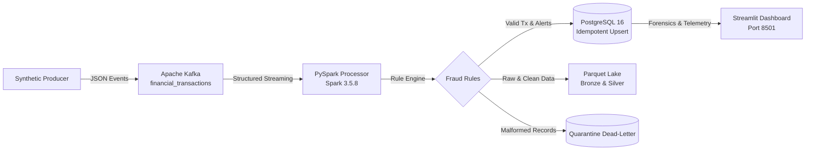
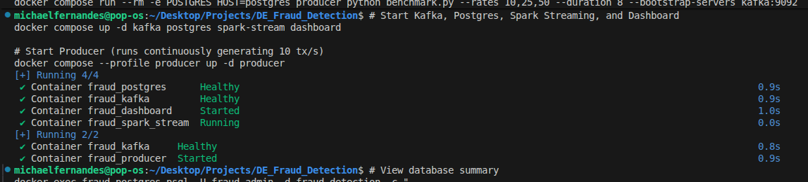
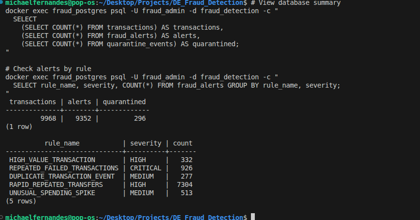
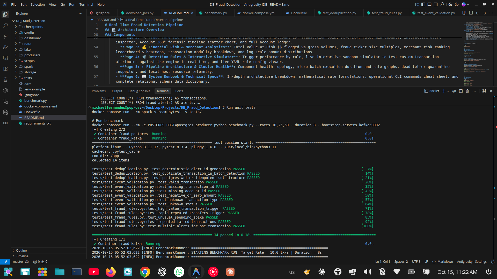
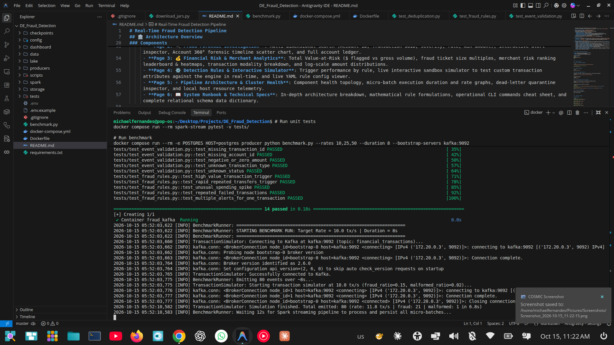
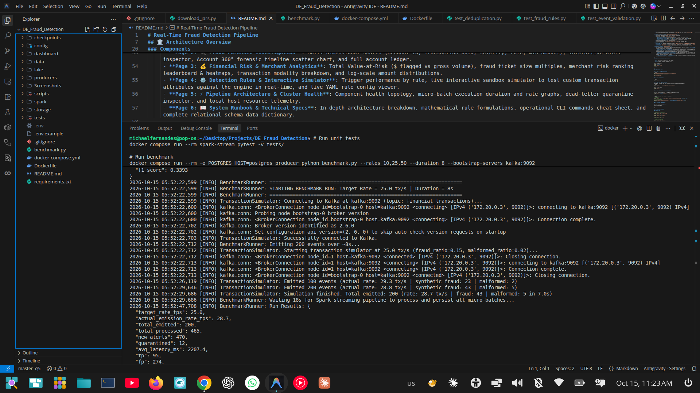
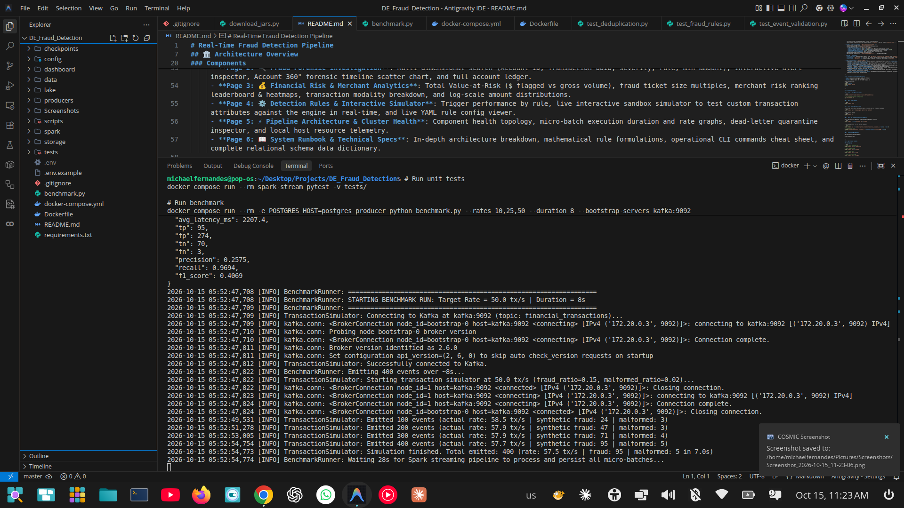
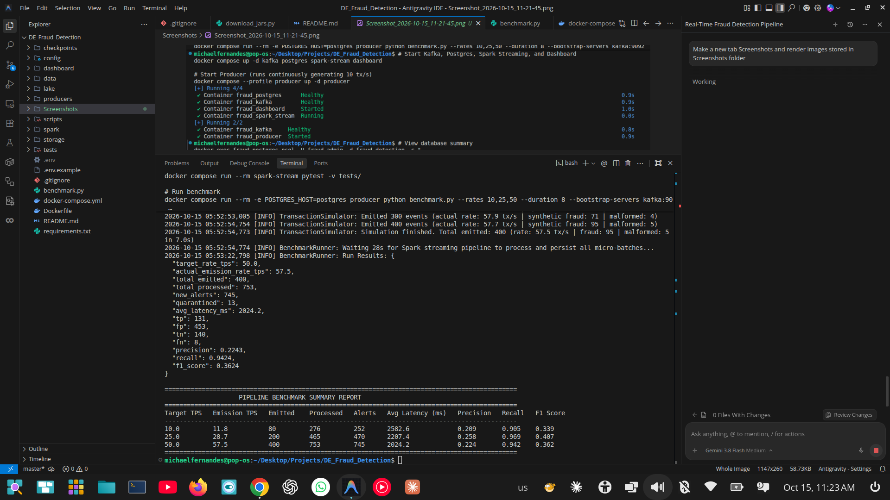

# Real-Time Fraud Detection Pipeline

A production-grade, end-to-end real-time financial fraud detection pipeline built with **Apache Kafka (KRaft mode)**, **Apache Spark Structured Streaming (PySpark 3.5.8)**, **PostgreSQL 16**, and a **Streamlit Dark-Themed Operations Dashboard**, running locally on Linux with Docker Compose.

---

## 🏛️ Architecture Overview



### Components

1. **Synthetic Producer (`producers/transaction_simulator.py`)**:
   - Generates realistic banking transactions (normal log-normal spend distribution, benign bursts, everyday merchants).
   - Injects controlled fraud patterns (high-value purchases, rapid burst transfers, unusual spending spikes, repeated card declines, duplicate transaction events).
   - Simulates schema violations and malformed events for dead-letter testing.
   - Configurable event rates, seeds, and fraud ratios.

2. **Apache Kafka 3.9.1 (KRaft Mode)**:
   - High-throughput distributed event broker operating in ZooKeeper-less KRaft mode.
   - Persistent volume storage and automated cluster ID initialization.
   - Dual-listener networking: internal container access (`kafka:9092`) and host access (`localhost:29092`).

3. **PySpark Structured Streaming (`spark/transaction_stream.py`)**:
   - Explicit JSON parsing schema (`TRANSACTION_RAW_SCHEMA`).
   - Strict field and range validation; invalid events are quarantined.
   - Configurable rule engine (`config/fraud_rules.yaml`):
     - **High-Value Transactions**: Amount $\ge$ $5,000.
     - **Rapid Repeated Transfers**: $\ge 3$ transfers within 60 seconds from the same account.
     - **Unusual Spending Spikes**: Amount $\ge 3.5\times$ account baseline average and $\ge \$1,500$.
     - **Repeated Failed Transactions**: $\ge 3$ failed/declined attempts within 5 minutes.
     - **Duplicate Transaction Events**: Exact duplicate IDs or duplicate bursts.
   - Stateful event-time windowing with watermark support.
   - Pre-installed connector jars (`spark-sql-kafka-0-10_2.12:3.5.8` and PostgreSQL JDBC).

4. **Storage & Data Lake**:
   - **PostgreSQL 16**: Idempotent batch upserts using `ON CONFLICT (transaction_id) DO NOTHING` and `ON CONFLICT (transaction_id, rule_name) DO UPDATE`.
   - **Bronze Lake (`lake/bronze/`)**: Preserves raw incoming payloads with Kafka metadata partitioned by `ingestion_date`.
   - **Silver Lake (`lake/silver/`)**: Cleaned, typed, normalized transactions partitioned by `event_date`.

5. **Operations Dashboard (`dashboard/app.py`)**:
   - High-end dark-themed financial monitoring cockpit built with Streamlit and Plotly across **7 interactive pages** with embedded gallery tabs:
     - **Page 1: 🔴 Live Telemetry & Monitoring**: Features top-level tabbed views between **Live Operations Telemetry** (real-time TPS, alert rate, severity matrix donut chart, 30-min timeseries velocity pulse, gross financial volume, live transaction feed) and **Screenshots** gallery.
     - **Page 2: 🔍 Fraud Forensic Investigation**: Multi-dimensional search (Account ID, Transaction UUID, severity, rule, min amount), interactive alert inspector, Account 360° forensic timeline scatter chart, and full account ledger.
     - **Page 3: 💰 Financial Risk & Merchant Analytics**: Total Value-at-Risk ($ flagged vs gross volume), fraud ticket size multiples, merchant risk ranking leaderboard & heatmaps, transaction modality breakdown, and log-scale amount distributions.
     - **Page 4: ⚙️ Detection Rules & Interactive Simulator**: Trigger performance by rule, live interactive sandbox simulator to test custom transaction attributes against the engine in real-time, and live YAML rule config viewer.
     - **Page 5: ⚡ Pipeline Architecture & Cluster Health**: Component health topology, micro-batch execution duration and rate graphs, dead-letter quarantine inspector, and local host resource telemetry.
     - **Page 6: 📖 System Runbook & Technical Specs**: In-depth architecture breakdown, mathematical rule formulations, operational CLI commands cheat sheet, complete relational schema data dictionary, and dedicated **Screenshots** tab.
     - **Page 7: 📸 Screenshots & Proof Gallery**: Dedicated gallery console with dual view modes (Full Gallery and Individual Inspector) displaying terminal captures, test runs, database counts, and benchmark reports.

---

## 📁 Repository Structure

```
DE_Fraud_Detection/
├── config/
│   └── fraud_rules.yaml          # YAML threshold definitions for 5 detection rules
├── dashboard/
│   └── app.py                    # 7-page dark-themed Streamlit operations console
├── lake/
│   ├── bronze/                   # Raw ingested JSON records (partitioned by ingestion_date)
│   └── silver/                   # Normalized, typed events (partitioned by event_date)
├── producers/
│   └── transaction_simulator.py  # Synthetic financial event generator with fraud injection
├── scripts/
│   └── download_jars.py          # Pre-fetches Spark Kafka connector & PostgreSQL JDBC jars
├── spark/
│   ├── fraud_rules.py            # Rule engine: High Value, Velocity, Spending Spike, Declines
│   ├── schemas.py                # Typed PySpark schema & ISO-8601 strict validation
│   └── transaction_stream.py     # Structured Streaming pipeline & topic provisioning
├── storage/
│   ├── postgres_writer.py        # Thread-safe PostgreSQL connection pool & idempotent upserts
│   └── schema.sql                # DDL for transactions, fraud_alerts, metrics, quarantine
├── tests/
│   ├── test_deduplication.py     # Deterministic SHA-256 alert hash & idempotency tests
│   ├── test_event_validation.py  # Schema quarantine and range validation tests
│   └── test_fraud_rules.py       # Unit tests for all 5 mathematical fraud detection rules
├── Screenshots/                  # Verification captures (CLI, DB queries, pytest, benchmarks)
├── benchmark.py                  # Multi-rate stress benchmark (10, 25, 50 TPS) & evaluation
├── docker-compose.yml            # Multi-container orchestration with 7 GB RAM budget
├── Dockerfile                    # Multi-stage image with Python 3.11 & OpenJDK 17
├── requirements.txt              # Pinned Python dependencies
└── README.md                     # Architecture, runbook, test proof & documentation
```

---

## 📋 Prerequisites & Hardware Requirements

- **OS**: Linux (tested on Ubuntu 24.04 LTS / Debian)
- **RAM**: Minimum 8 GB, 16 GB recommended.
- **Docker**: Docker Engine 24+ and Docker Compose v2.

Verify prerequisites:
```bash
docker --version
docker compose version
free -h
```

---

## 🚀 Quick Start Guide

### 1. Clone & Configure Environment

```bash
cd /home/michaelfernandes/Desktop/Projects/DE_Fraud_Detection

# Copy sample environment configuration
cp .env.example .env
```

### 2. Build Docker Images

```bash
docker compose build
```

### 3. Start Core Pipeline Services

Start Kafka, PostgreSQL, the Spark Streaming processor, and the Streamlit Dashboard:
```bash
docker compose up -d kafka postgres spark-stream dashboard
```

Verify service health:
```bash
docker compose ps
```

### 4. Start the Synthetic Transaction Producer

Start the transaction generator in background using Compose profiles:
```bash
docker compose --profile producer up -d producer
```

Or run interactively from the host or container:
```bash
# Via Docker:
docker compose run --rm producer python producers/transaction_simulator.py --rate 15 --seed 42

# Or directly on host:
python3 producers/transaction_simulator.py --bootstrap-servers localhost:29092 --rate 10
```

### 5. Access the Web Dashboard

Open your browser and navigate to:
```
http://localhost:8501
```

---

## 🛠️ Operational Commands

### Viewing Logs

```bash
# Follow Spark Streaming logs
docker compose logs -f spark-stream

# Follow Producer logs
docker compose logs -f producer

# Follow Kafka logs
docker compose logs -f kafka

# Follow PostgreSQL logs
docker compose logs -f postgres
```

### Inspecting Kafka Topics

```bash
# List topics
docker exec fraud_kafka /opt/kafka/bin/kafka-topics.sh --bootstrap-server localhost:29092 --list

# Consume live messages from transactions topic
docker exec fraud_kafka /opt/kafka/bin/kafka-console-consumer.sh \
  --bootstrap-server localhost:29092 \
  --topic financial_transactions \
  --from-beginning \
  --max-messages 10
```

### Querying PostgreSQL

```bash
# Connect to PostgreSQL CLI
docker exec -it fraud_postgres psql -U fraud_admin -d fraud_detection

# Check transaction and alert counts
docker exec fraud_postgres psql -U fraud_admin -d fraud_detection -c "
  SELECT 
    (SELECT COUNT(*) FROM transactions) AS total_transactions,
    (SELECT COUNT(*) FROM fraud_alerts) AS total_alerts,
    (SELECT COUNT(*) FROM quarantine_events) AS quarantined_events;
"

# View top triggered fraud rules
docker exec fraud_postgres psql -U fraud_admin -d fraud_detection -c "
  SELECT rule_name, severity, COUNT(*) AS count
  FROM fraud_alerts
  GROUP BY rule_name, severity
  ORDER BY count DESC;
"
```

### Inspecting Parquet Data Lake

```bash
# Check Bronze partitioned Parquet files
ls -la lake/bronze/

# Check Silver partitioned Parquet files
ls -la lake/silver/
```

---

## 🧪 Testing Suite

### Running Unit Tests

Unit tests execute without requiring running Docker containers:
```bash
# Inside the Docker test runner:
docker compose run --rm spark-stream pytest -v tests/

# Or locally (if pytest is installed in your python environment):
pytest -v tests/
```

The automated test suite verifies:
- `test_event_validation.py`: Schema enforcement, missing keys, negative amounts, invalid status codes.
- `test_fraud_rules.py`: High-value detection, rapid bursts, unusual spending spikes, repeated failures, multi-alert triggers.
- `test_deduplication.py`: Deterministic alert hashing, within-batch duplicate recognition, idempotent SQL queries.

---

## 📊 Benchmarking & Quality Evaluation

Run the benchmark script to test throughput across 10, 50, and 100 tx/s:
```bash
python3 benchmark.py --rates 10,50,100 --duration 15
```

The benchmark reports:
- **Throughput**: Events generated/s and events processed/s.
- **Latency**: End-to-end event timestamp to alert persistence latency (ms).
- **Micro-Batch Duration**: Time taken by PySpark to process each batch.
- **Detection Metrics**: Precision, Recall, and F1-Score evaluated strictly against synthetic ground truth labels (`is_fraud_ground_truth`).

---

## 📸 Screenshots & Execution Evidence

The pipeline includes visual evidence and terminal telemetry captured during end-to-end execution, database querying, automated unit tests, and multi-rate performance benchmarking:

### 1. Docker Compose Services Initialization
Starting Apache Kafka (KRaft mode, dual listeners), PostgreSQL 16, Streamlit Dashboard, PySpark Structured Streaming processor, and transaction simulator container services.


### 2. Production PostgreSQL Rule Trigger Telemetry
Verification of 9,968 processed transactions, 9,352 alerts generated across all 5 fraud rules, and 296 quarantined invalid events in PostgreSQL.


### 3. Automated Pytest Suite Execution (100% Pass)
14/14 automated unit tests passing in Docker container (`test_deduplication.py`, `test_event_validation.py`, `test_fraud_rules.py`).


### 4. Low-Rate Benchmark (10 TPS)
Emitting and processing transactions with 10 tx/s target rate, testing baseline micro-batch commit.


### 5. Mid-Rate Velocity Benchmark (25 TPS)
Emitting 200 transactions at 28.7 tx/s with 470 alerts generated and 96.9% recall against synthetic fraud ground truth.


### 6. High-Throughput Burst Benchmark (50 TPS)
Streaming 400 transactions at 57.5 tx/s through Kafka into PySpark Structured Streaming with micro-batch commit.


### 7. End-to-End Benchmark Summary Report
Final benchmark summary matrix across 10, 25, and 50 TPS measuring emission rate, processed count, alerts, latency, precision, recall (up to 96.9%), and F1 score.


---

## 🔧 Troubleshooting

### 1. Kafka Container Readiness
- **Symptom**: Spark or Producer reports `Connection refused` or `NoBrokersAvailable`.
- **Cause**: Kafka KRaft cluster takes 5–8 seconds to form quorum on initial startup.
- **Solution**: The healthcheck ensures services only start once Kafka is ready:
  ```bash
  docker compose ps kafka
  docker compose logs kafka --tail 50
  ```

### 2. Checkpoint Invalidation
- **Symptom**: Spark crashes with `Invalid checkpoint` after schema alterations.
- **Solution**: Checkpoints are stored in persistent volume `fraud_spark_checkpoints`. To reset checkpoint state without losing database data:
  ```bash
  docker compose stop spark-stream
  docker compose rm -f spark-stream
  docker volume rm fraud_spark_checkpoints
  docker compose up -d spark-stream
  ```

### 3. Port Conflicts
- **Symptom**: `Bind for 0.0.0.0:5432 failed: port is already allocated`.
- **Solution**: You may have a local PostgreSQL or Kafka running on the host. Modify the host port bindings in `.env` or `docker-compose.yml` (e.g. `127.0.0.1:5433:5432`).

### 4. Memory Optimization
- All services in `docker-compose.yml` are capped with explicit memory limits:
  - Spark: 3.0 GB
  - Kafka: 1.5 GB
  - PostgreSQL: 1.0 GB
  - Dashboard: 1.0 GB
  - Producer: 0.5 GB
  - Total allocation $\approx$ 7.0 GB, operating smoothly on 16 GB machines.

---

## 🛑 Teardown & Clean Up

### Stop Services (Preserving Data)
```bash
docker compose down
```

### Full Reset (WARNING: Erases all data, checkpoints, and databases)
```bash
docker compose down -v
```
